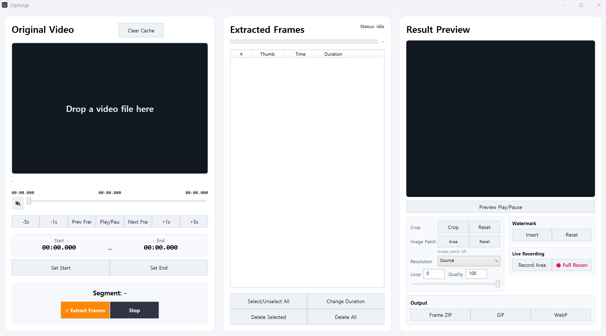

# ClipForge

Made with OpenAI Codex.  
OpenAI Codex를 이용해서 제작했습니다.

ClipForge is a portable Windows tool for extracting video frames, editing timing and composition, and exporting GIF/WebP animations.  
ClipForge는 영상에서 프레임을 추출하고 재생 시간과 화면 구성을 편집해 GIF/WebP 애니메이션으로 저장하는 Windows 포터블 도구입니다.

## Download / 다운로드

Download the Windows x64 portable ZIP from [ClipForge v0.3.0-preview.1](https://github.com/StynerPark/ClipForge/releases/tag/v0.3.0-preview.1), extract it, and run `ClipForgeWpf.exe`. No installer is required.  
[ClipForge v0.3.0-preview.1](https://github.com/StynerPark/ClipForge/releases/tag/v0.3.0-preview.1)에서 Windows x64 포터블 ZIP을 다운로드하고 압축을 푼 뒤 `ClipForgeWpf.exe`를 실행하세요. 별도 설치는 필요하지 않습니다.

## Highlights / 주요 기능

- Load a video by drag and drop, seek freely, set start/end points, and extract frames.  
  영상을 드래그해 불러오고 원하는 위치를 탐색한 뒤 시작/종료 지점을 지정해 프레임을 추출합니다.
- Reorder work across multiple clips or recordings, select frames, edit frame duration, and delete selected/all frames.  
  여러 영상과 녹화 프레임을 한 목록에서 작업하고 선택, 지속시간 변경, 선택/전체 삭제를 할 수 있습니다.
- Crop the output, choose the output resolution, and add image or text watermarks.  
  출력 영역 크롭, 해상도 선택, 이미지·텍스트 워터마크 추가를 지원합니다.
- Record the full screen or a selected screen area and append captured frames to the frame list.  
  전체 화면 또는 선택 영역을 녹화하고 캡처 프레임을 목록에 추가합니다.
- Export original frames as a ZIP or render the edited result as GIF/WebP.  
  원본 프레임을 ZIP으로 저장하거나 편집 결과를 GIF/WebP로 출력합니다.
- Preview feature: replace a freely drawn area with pixels from an edited full-frame image using **Image Patch**.  
  프리뷰 기능: **Image Patch**에서 자유 선택한 영역을 수정된 전체 프레임 이미지의 같은 좌표 픽셀로 교체합니다.

## Image Patch workflow / 이미지 패치 사용 순서

### English

1. Drop a video into **Original Video**, set the extraction range with **Set Start** and **Set End**, then select **Extract Frames**.
2. Copy one PNG frame from the current session folder under `tmp` to another location. Temporary files can be removed when the app exits or **Clear Cache** is used.
3. Remove the unwanted logo or fixed element in an external image editor. Keep the original pixel dimensions and save the entire edited frame; PNG is recommended.
4. Select a frame in **Extracted Frames**, then choose **Image Patch > Area**.
5. Hold the left mouse button and draw a freehand boundary around the area to replace. Releasing the button closes the selection.
6. Drop the edited full-frame image into the editor, or use **Load image…**. The image must have the same width and height as the source frame.
7. Check the composited preview, compare it with **Show original**, and adjust **Feather (px)** if needed.
8. Select **Apply to all frames**, verify the result in **Result Preview**, then export a GIF or WebP.

### 한국어

1. **Original Video**에 영상을 드래그하고 **Set Start**, **Set End**로 구간을 정한 뒤 **Extract Frames**를 누릅니다.
2. 프로그램의 `tmp` 아래 현재 세션 폴더에서 PNG 프레임 한 장을 다른 위치로 복사합니다. 앱 종료나 **Clear Cache**로 임시 파일이 정리될 수 있습니다.
3. 외부 이미지 편집기에서 로고나 고정 요소를 지웁니다. 원본 픽셀 크기를 유지한 전체 프레임으로 저장하며 PNG를 권장합니다.
4. **Extracted Frames**에서 확인할 프레임을 선택하고 **Image Patch > Area**를 누릅니다.
5. 마우스 왼쪽 버튼을 누른 채 교체할 부분을 자유롭게 둘러 그립니다. 버튼을 놓으면 선택 영역이 닫힙니다.
6. 수정한 전체 프레임 이미지를 편집 창에 드래그하거나 **이미지 불러오기…**를 사용합니다. 원본 프레임과 가로·세로 픽셀 수가 같아야 합니다.
7. 합성 미리보기를 확인하고 **원본 보기**로 비교한 뒤 필요하면 **경계(px)**를 조절합니다.
8. **모든 프레임에 적용**을 누르고 **Result Preview**에서 확인한 다음 GIF 또는 WebP로 저장합니다.

Image Patch uses pixels from the same coordinates in the edited image; it does not scale the full image into the selected area. A feather value of `0` performs an exact replacement. Higher values blend the inside edge while preserving pixels outside the selection.  
Image Patch는 수정 이미지 전체를 선택 영역에 축소하지 않고 동일한 좌표의 픽셀만 가져옵니다. 경계값 `0`은 영역 내부를 그대로 교체하고, 값을 높이면 선택 영역 밖은 유지하면서 안쪽 경계를 부드럽게 섞습니다.

## Button guide / 버튼 기능

| Button | English | 한국어 |
|---|---|---|
| Clear Cache | Clears temporary work files and current cached state. Save anything you need first. | 임시 작업 파일과 현재 캐시 상태를 정리합니다. 필요한 작업물을 먼저 저장하세요. |
| -5s / -1s / +1s / +5s | Moves the source position by the selected time step. | 원본 영상 위치를 선택한 시간만큼 이동합니다. |
| Prev Frame / Next Frame | Steps through the source video frame by frame. | 원본 영상을 프레임 단위로 이동합니다. |
| Play/Pause | Plays or pauses the source video. | 원본 영상 재생/일시 정지를 전환합니다. |
| Set Start / Set End | Sets the frame extraction start or end point. | 프레임 추출 시작점/종료점을 설정합니다. |
| Extract Frames / Stop | Starts or stops frame extraction. | 프레임 추출을 시작하거나 중지합니다. |
| Select/Unselect All | Selects or clears all extracted frames. | 추출 프레임 전체를 선택하거나 선택 해제합니다. |
| Change Duration | Changes the playback duration of selected frames. | 선택한 프레임의 재생 지속시간을 변경합니다. |
| Delete Selected / Delete All | Removes selected frames or all frames. | 선택 프레임 또는 모든 프레임을 삭제합니다. |
| Preview Play/Pause | Plays or pauses the result preview. | 결과 미리보기를 재생하거나 일시 정지합니다. |
| Crop / Reset | Opens crop selection or clears the crop. | 크롭 영역을 지정하거나 크롭 설정을 초기화합니다. |
| Image Patch — Area / Reset | Opens the freehand image-patch editor or disables the applied patch. | 자유 선택 이미지 패치 편집창을 열거나 적용된 패치를 해제합니다. |
| Watermark — Insert / Reset | Adds image/text overlays or removes all overlays. | 이미지·텍스트 워터마크를 추가하거나 모두 제거합니다. |
| Record Area / Full Record | Records a selected screen area or the full screen. | 선택 영역 또는 전체 화면을 녹화합니다. |
| Frame ZIP | Saves the original extracted frames. Image Patch is not applied. | 추출한 원본 프레임을 저장합니다. Image Patch는 적용되지 않습니다. |
| GIF / WebP | Renders the preview, crop, Image Patch, resolution, timing, and overlays. | 미리보기, 크롭, Image Patch, 해상도, 재생 시간, 워터마크를 반영해 출력합니다. |

## Image Patch limitations / 이미지 패치 제한사항

- The edited image must have exactly the same pixel dimensions as the source frame.  
  수정 이미지는 원본 프레임과 픽셀 크기가 정확히 같아야 합니다.
- The patch is fixed in place. People, hair, or objects moving through the area can be covered by the patch. It is not object tracking or AI restoration.  
  패치는 고정 위치에 적용됩니다. 영역을 지나가는 사람, 머리카락, 물체도 가릴 수 있으며 움직임 추적이나 AI 복원 기능은 아닙니다.
- One patch area is active at a time; drawing a new area replaces the previous one.  
  한 번에 하나의 패치 영역만 사용하며 새 영역을 그리면 이전 영역을 대체합니다.
- The current preview stores patch settings only for the active session. Closing the app or clearing the working state requires the patch to be set again.  
  현재 프리뷰는 패치 설정을 현재 세션에서만 유지합니다. 앱 종료나 작업 초기화 후에는 다시 지정해야 합니다.
- Original `tmp` frames and center-panel thumbnails remain unchanged. Image Patch is applied to Result Preview and GIF/WebP output, not Frame ZIP.  
  `tmp` 원본과 가운데 썸네일은 변경하지 않습니다. Image Patch는 Result Preview와 GIF/WebP에 반영되며 Frame ZIP에는 적용되지 않습니다.

## Portable build / 포터블 빌드

The release ZIP is self-contained for Windows x64 and includes FFmpeg, LibVLC, and the OpenCV runtime required by the preview Image Patch feature.  
릴리스 ZIP은 Windows x64용 포터블 패키지이며 FFmpeg, LibVLC 및 프리뷰 Image Patch 기능에 필요한 OpenCV 런타임을 포함합니다.

## Source / 소스

The project is built with .NET 8 WPF, LibVLCSharp, FFmpeg, and System.Drawing screen capture. The Image Patch implementation is currently distributed in the preview portable build.  
이 프로젝트는 .NET 8 WPF, LibVLCSharp, FFmpeg, System.Drawing 화면 캡처를 기반으로 합니다. Image Patch 구현은 현재 프리뷰 포터블 빌드에 포함되어 배포됩니다.

